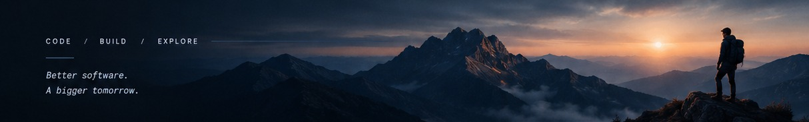

 

# Hi, I'm `@kydspr` 👋

### FULL-STACK DEVELOPER · BACKEND ENGINEER · CURIOUS EXPLORER

**Better software. A bigger tomorrow.**

[GitHub](https://github.com/kydspr) &nbsp;·&nbsp; [Instagram](https://www.instagram.com/kydspr) &nbsp;·&nbsp; [LinkedIn](https://www.linkedin.com/in/kydspr) &nbsp;·&nbsp; [Portfolio](https://kydspr.com)

---

<table>
<tr>
<td width="62%" valign="top">

## 👨‍💻 About Me

I'm a developer who enjoys turning ideas into useful digital products. I work across the stack—from backend systems and APIs to modern web interfaces and mobile apps.

I care about solving real problems, building maintainable systems, and continuously improving the way software is designed and delivered.

**Currently interested in:** Laravel · Flutter · AI · Full-Stack Engineering

> *Great software isn't just about code—it's about solving real problems for real people.*

## ⚙️ What I Do

### 🌐 Web Development
Build web applications, REST APIs, and maintainable backend systems with Laravel.

### 📱 Mobile Development
Explore cross-platform app development with Flutter and Dart.

### 🤖 AI & Automation
Experiment with AI-powered tools and smarter workflows.

### ☁️ Backend & DevOps
Work with databases, Linux, Nginx, deployment workflows, and application performance.

## 🚀 Featured Projects

> Replace these examples with your actual repositories.

| Project | What it is |
|:--|:--|
| [FilloHub](https://kydspr.com/fillohub) | Web application built with Laravel |
| [SelangkahClvb](https://kydspr.com/selangkahclvb) | Cross-platform mobile app with Flutter |
| [Fillo Projects](https://kydspr.com/filloprojects) | Backend service or API |

</td>
<td width="38%" valign="top">

## 🧰 Tech Stack

**Backend**

**Frontend & Mobile**

**Tools & Infrastructure**

## 🏔️ Beyond Coding

**Hiking & Outdoors**  
Finding perspective on the trail.

**Running**  
Building consistency, one step at a time.

**Exploring**  
Discovering new places and collecting experiences.

## 🎯 Current Focus

- Building reliable, maintainable applications
- Improving full-stack engineering skills
- Exploring practical AI and automation
- Learning continuously through hands-on projects

</td>
</tr>
</table>

---

### LET'S CONNECT

 

**CODE&nbsp; / &nbsp;BUILD&nbsp; / &nbsp;EXPLORE**

*Build with purpose. Explore without limits. Never stop growing.*

